# Migration and Grief Narrative Analysis

Comparative NLP study of two Reddit post corpora:

| Corpus | Theme | Subreddits |
|--------|--------|------------|
| **A** | Migration / expat experiences | `r/expats`, `r/immigration`, `r/StudyAbroad` |
| **B** | Loss / grief experiences | `r/GriefSupport`, `r/bereavement` |

Posts only (no comments), longer than 100 words, roughly the last three years from mid-2023, with soft flair preference. Corpus A drops visa/tax/paperwork Q&A via keyword filters.

The project supports data collection (Apify), cleaning, and Phases 2–4 analysis: semantic comparison (PPMI, BERT, Word2Vec, FastText), emotion windows, co-occurrence networks, and topic modeling.

---

## Repository contents

```
config/           # filters, scrape plan, seed dictionary (anchors), analysis knobs
data/
  processed/      # Phase 1 cleaned corpus CSVs
  analysis/       # Corrected analysis corpus CSVs (primary research tables)
docs/
  figures/        # result figures embedded below
  METHODS_RESULTS.md
scripts/          # scrape → filter → analysis pipeline
tests/            # unit tests for shared analysis helpers
run_analysis.py   # Phase 2–4 orchestration (PPMI default path)
run_contextual_phase2.py   # frozen BERT path + methods join
run_predictive_phase2.py   # Word2Vec / FastText evaluation
```

### Included data

| File | Rows (approx.) | Role |
|------|----------------|------|
| `data/analysis/corpus_a.csv` | 906 | **Primary** migration corpus for Phases 2–4 |
| `data/analysis/corpus_b.csv` | 687 | **Primary** grief corpus for Phases 2–4 |
| `data/processed/corpus_a.csv` | 323 | Earlier Phase 1 freeze (pre-filter recovery) |
| `data/processed/corpus_b.csv` | 687 | Phase 1 grief corpus |

Prefer **`data/analysis/`** for new analysis. The analysis corpus recovers posts that an over-broad keyword filter had dropped from Corpus A (substring false positives). Raw Apify dumps and large intermediates are not in git (regenerate or restore locally).

Typical columns: `post_id`, `corpus`, `subreddit`, `title`, `body`, `text`, `created_at`, `url`, `flair`, `score`, `word_count`, `username`, plus cleaned/token fields depending on stage.

> **Privacy:** CSVs include Reddit identifiers and post text. This repository is private by design. Do not publish row-level dumps without ethics/privacy review.

---

## Results so far (analysis corpus: A = 906, B = 687)

All numbers and figures below are from the **current sample**, not the long-term target of ~10k posts per corpus. Scraping is paused; collecting more data would require re-running analysis as a new sampling frame.

Figures are stored in [`docs/figures/`](docs/figures/) and rendered inline on GitHub.

### Project status

| Stage | Status | Notes |
|-------|--------|--------|
| Data collection | Partial | Clean analysis CSVs in repo; volume far below 10k×2 target |
| Seed dictionary | Done | 4 domains, 71 anchors (`config/anchors.yaml`) |
| Semantic comparison (Phase 2) | Done | PPMI, frozen BERT, Word2Vec, FastText |
| Emotion windows (Phase 3) | Done | DistilRoBERTa-emotion; ABSA-style **proxy** (not trained ABSA) |
| Co-occurrence networks | Done | PPMI-weighted graphs (exploratory) |
| Topic model (Phase 4) | Done | Pooled NMF, k = 8 by stability |
| Manual emotion annotation | Template only | 150-window sample prepared; coding not finished |

### Seed domains

| Domain | Focus (keywords include) |
|--------|---------------------------|
| **Temporal** | timezone, weekend, schedule, distance, stuck, … |
| **Identity** | name, accent, belong, culture shock, foreigner, … |
| **Absence** | alone, lost, gone, missing, ghost, funeral, … |
| **Digital** | skype, screen, wifi, video call, connection, … |

**Domain coverage** (share of posts hitting each domain; full dictionary vs strict/non-polysemous):

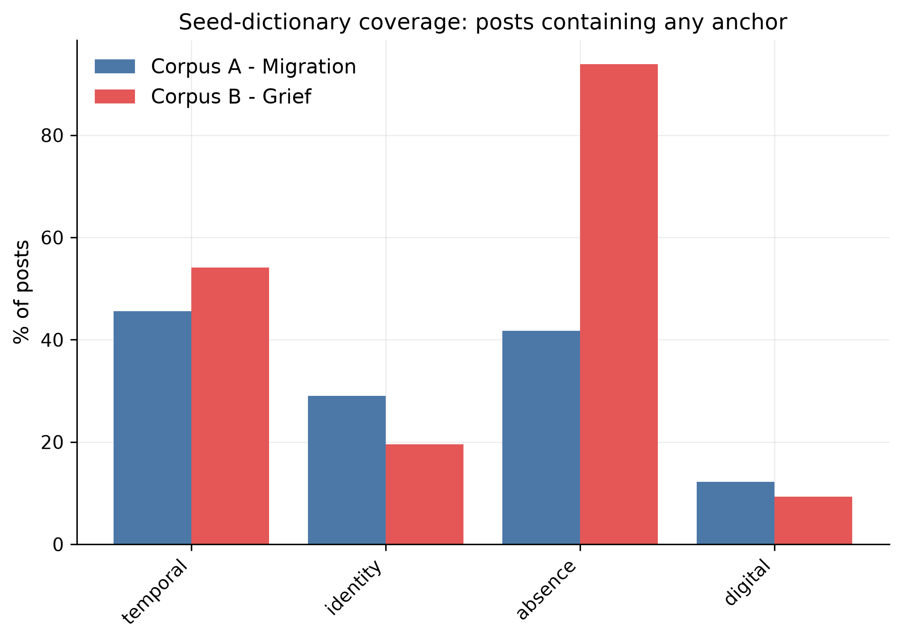

Absence dominates grief posts (Corpus B); identity is denser in migration (Corpus A). Digital is the sparsest domain in both.

---

### 1. Semantic similarity (Corpus A vs B)

We compare how each domain is represented in migration vs grief posts.  
**cos\*** = attenuation-corrected cosine (higher ≈ more similar across corpora).  
Significance uses post-level resampling and Benjamini–Hochberg FDR where applicable.

| Domain | PPMI cos\* | PPMI different A vs B? | BERT cos\* | BERT residual difference? |
|--------|------------:|:----------------------:|------------:|:-------------------------:|
| Temporal | 0.72 | **Yes** (q ≈ 0.003) | 0.91 | Yes (q = 0.002) |
| Absence | 0.60 | **Yes** (q ≈ 0.003) | 0.91 | Yes (q = 0.002) |
| Identity | 0.58 | **Yes** (q ≈ 0.003) | 0.82 | Yes (q = 0.002) |
| Digital | 0.80 | No (q ≈ 0.08) | 0.96 | Yes (q = 0.002) |

**How to read this**

- **PPMI** measures collocational overlap (local co-occurrence profiles). Migration and grief **diverge** clearly for Temporal, Absence, and Identity; Digital is borderline.
- **BERT** (frozen `bert-base-uncased`) measures pretrained contextual senses. Domains are **mostly similar** across corpora (high cos\*), but still not interchangeable under a label-permutation null.
- These are **complementary**, not contradictory.

#### Domain profile geometry — PPMI

Eight points = 4 domains × 2 corpora. Colours mark corpus membership.

**PCA (PPMI context profiles)**

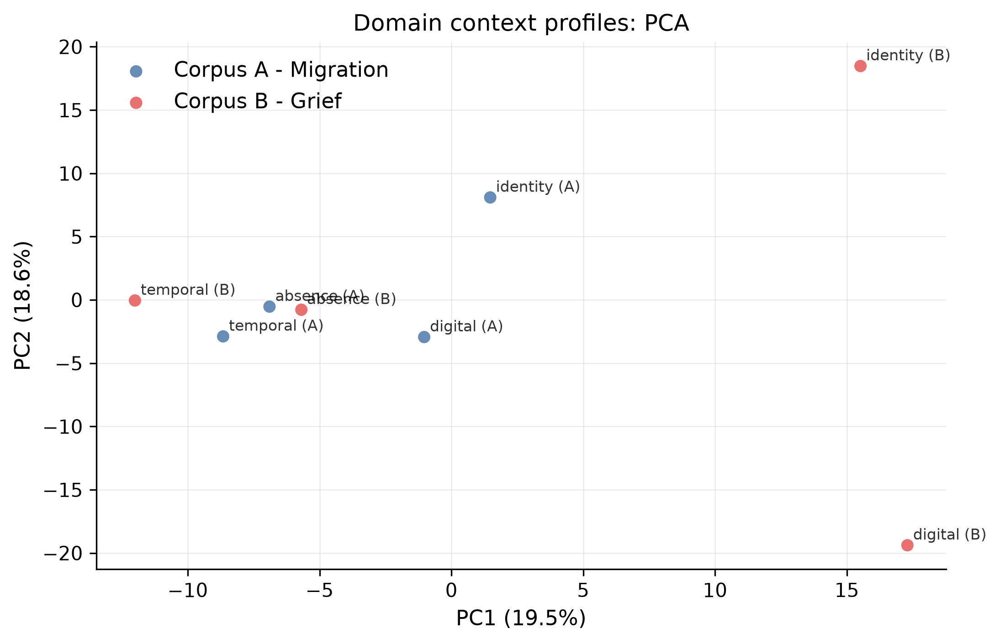

**t-SNE (PPMI context profiles)**

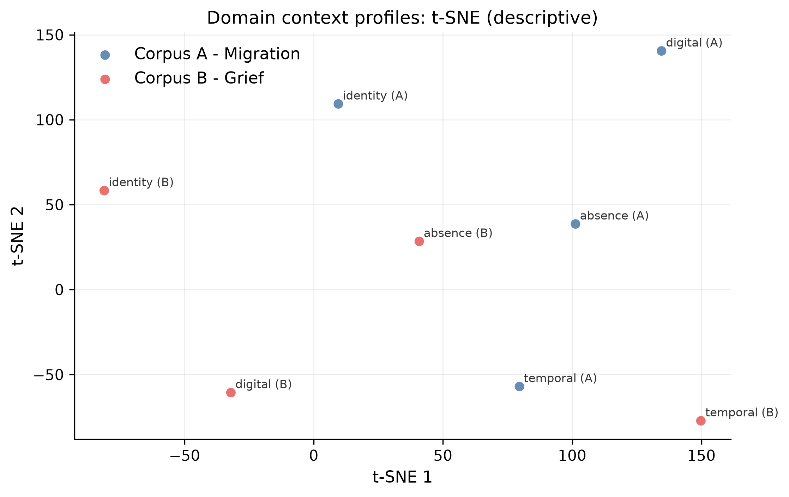

#### Domain profile geometry — frozen BERT

**PCA (BERT sense vectors)**

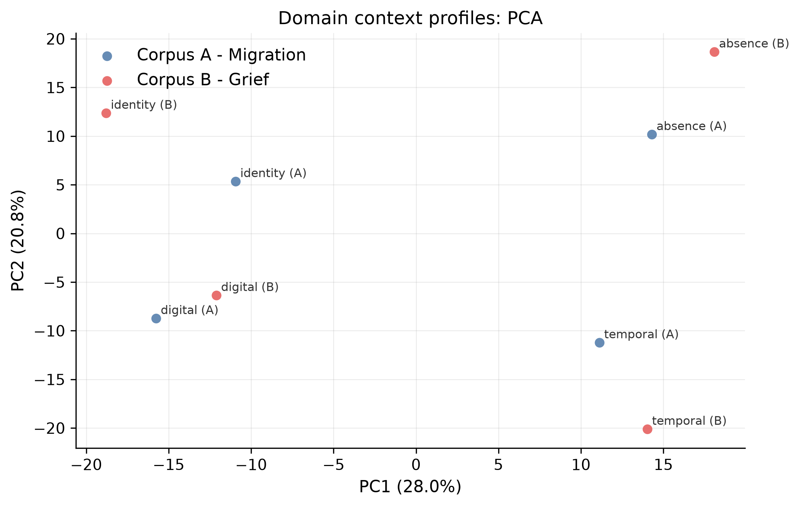

**t-SNE (BERT sense vectors)**

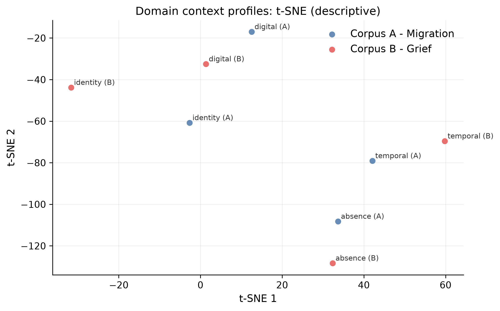

#### Multi-method comparison (PPMI vs BERT cos\*)

Points above the diagonal would mean BERT finds *more* cross-corpus similarity than PPMI (which is what we observe for every domain).

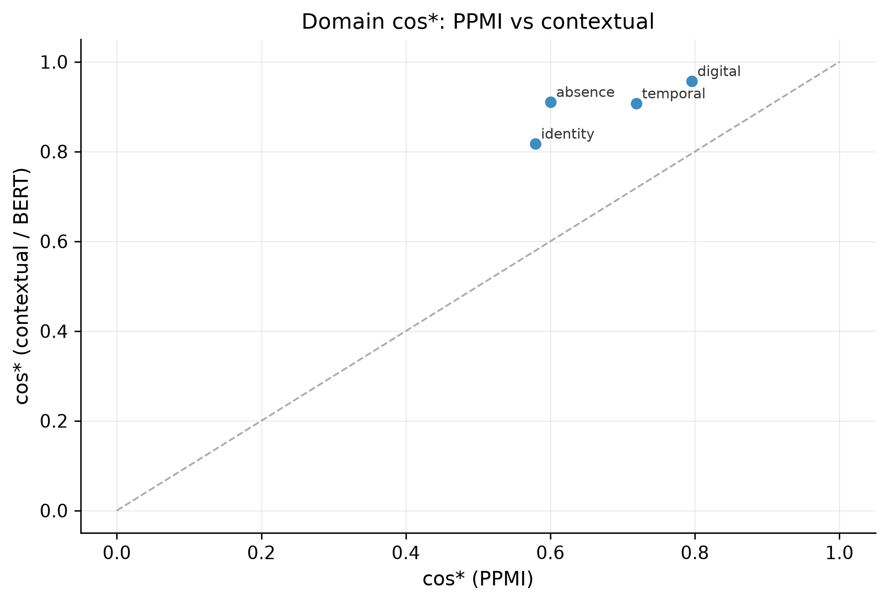

#### Word2Vec and FastText (trained on these texts)

Also evaluated with the same reliability design — not dismissed without a run:

| Method | Domain profile reliability (mean A / B) | Neighbour-list Jaccard (mean A / B) | Domain cos\* (approx.) |
|--------|------------------------------------------|-------------------------------------|-------------------------|
| BERT | 0.99 / 0.98 | **0.53 / 0.48** | 0.82–0.96 |
| FastText | 1.00 / 1.00 | 0.11 / 0.09 | ~0.98–0.99 |
| Word2Vec | 0.99 / 0.99 | 0.12 / 0.06 | ~0.98–0.99 |
| PPMI | 0.50 / 0.53 | 0.06 / 0.05 | 0.58–0.80 |

Chance neighbour Jaccard ≈ **0.014**.

**Takeaway at this sample size**

1. W2V/FT **domain profiles** are stable (high reliability).  
2. Their **top-15 neighbour lists** are only modestly above chance and much less stable than BERT’s — neighbour tables from W2V/FT are weak findings here.  
3. W2V/FT **cos\*** is near 1 (little A/B contrast). **PPMI** is most discriminative for collocates; **BERT** sits in between.  
4. At ~10k posts/corpus, re-run the same battery before stronger claims about predictive embeddings.

Usable individual anchors (frequency ≥ 20 in the weaker corpus **and** reliability gate): about **12/71** under PPMI and **8/71** under BERT. Prefer **domain-level** claims.

---

### 2. Emotion around anchors (Phase 3)

Model: `j-hartmann/emotion-english-distilroberta-base` (7 classes).  
Design: sentence-clipped ±5-token windows; one post per author for inference; polysemous anchors excluded from strict estimates; FDR across domain tests.

| Domain | Emotion distribution A vs B | FDR q |
|--------|----------------------------|------:|
| Identity | **Different** | 0.006 |
| Absence | **Different** | 0.0002 |
| Temporal | **Different** | 0.0003 |
| Digital | Not significant | 0.80 |

This is a **window proxy** for aspect-based emotion (emotion of local context; aspect ≈ anchor), not a trained ABSA model.

**Stacked emotion mix by domain and corpus**

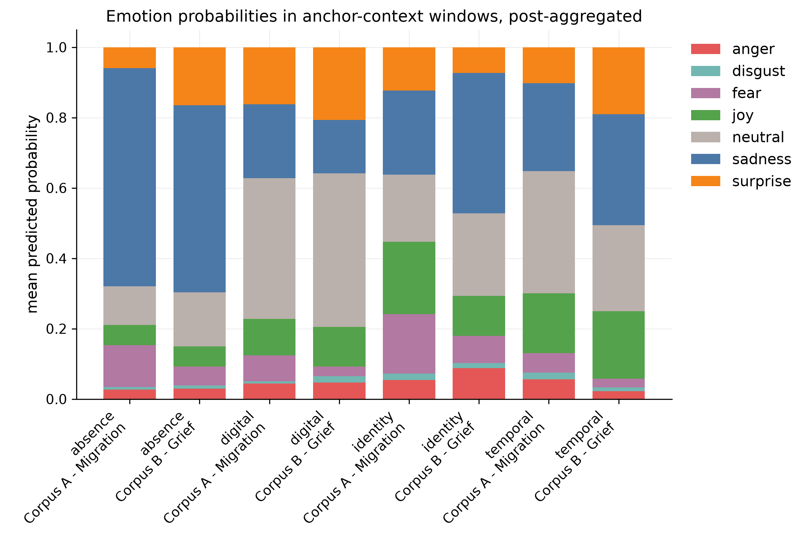

**Emotion difference heatmap** (Corpus A − Corpus B; cells with “\*” survive multiple-testing correction)

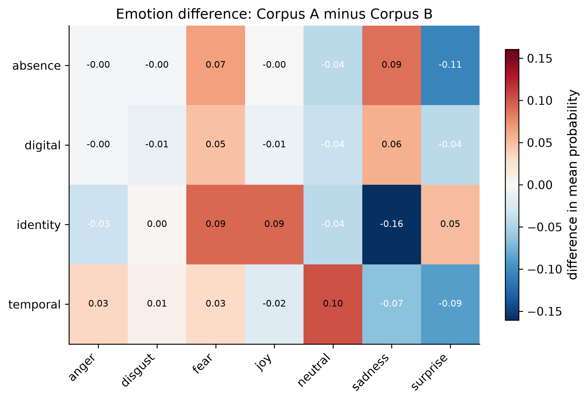

Identity / Absence / Temporal show clear distributional shifts; Digital does not survive FDR.

**Co-occurrence networks** (top 300 PPMI edges; exploratory — many edges have low raw counts)

**Corpus A — migration**

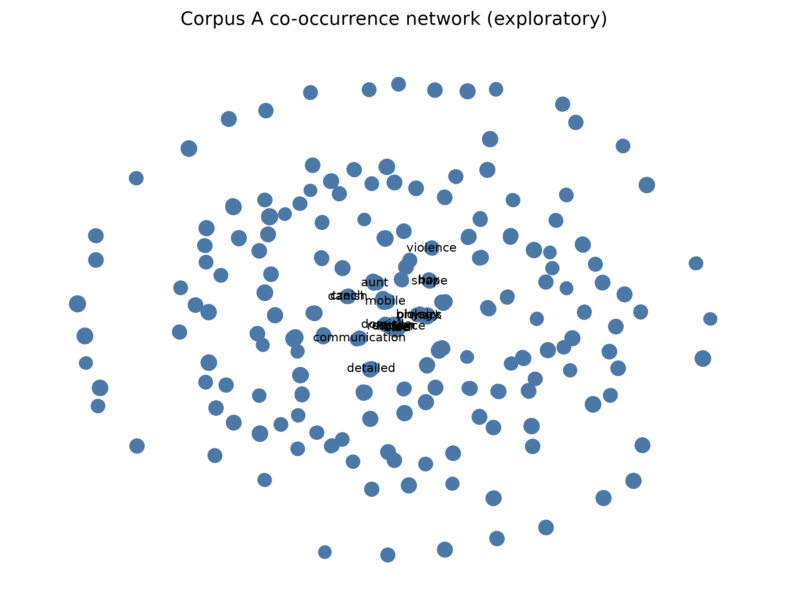

**Corpus B — grief**

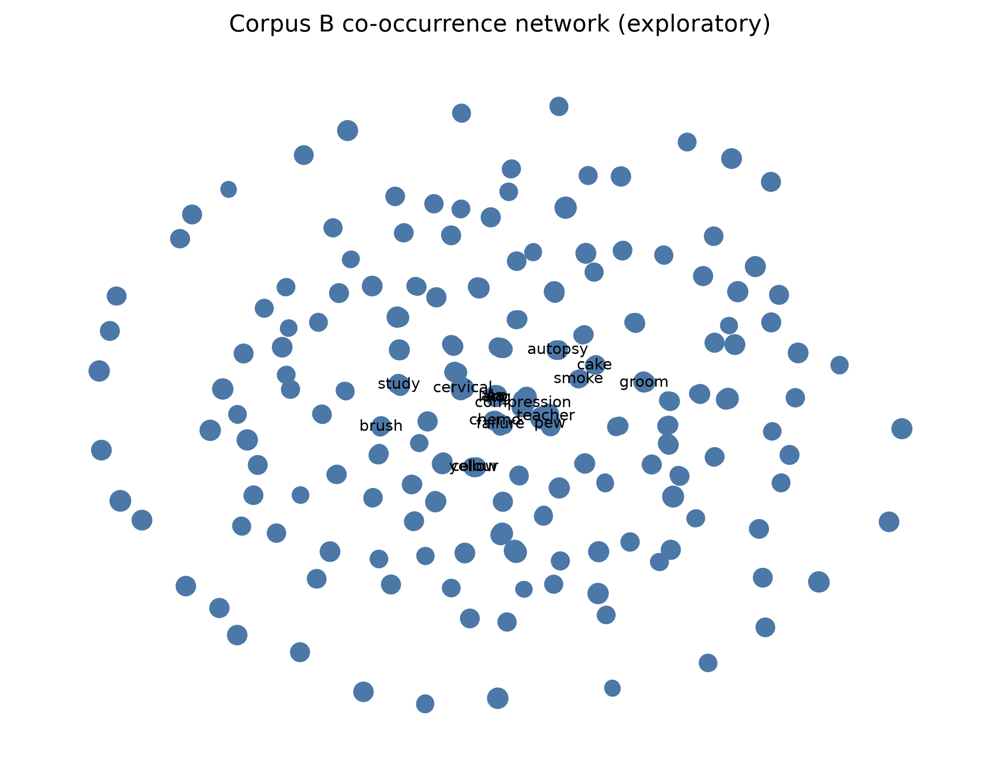

---

### 3. Topics (Phase 4)

- Method: pooled **NMF** on both corpora, TF–IDF, bootstrap stability selection.  
- Selected **k = 8**.  
- Only **Topic 2** meets the high-stability “core” threshold (recurrence ≈ 0.95): study-abroad / university language, **higher loading in Corpus A**.  
- Other topics (e.g. hospital/loss, homesick, job/move, family bereavement) appear but are **unstable** across restarts — report cautiously.

**Topic prevalence by corpus** (★ marks the only core/stable topic)

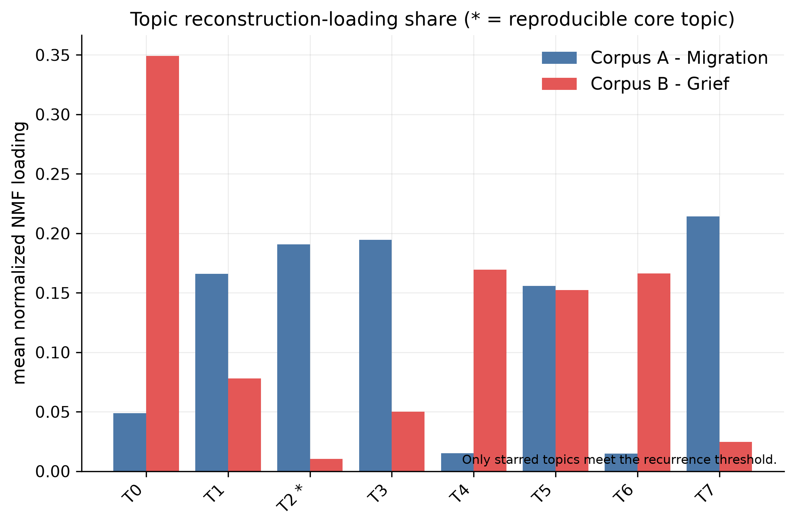

**Topic stability** across bootstrap runs (core threshold shown as a dashed line)

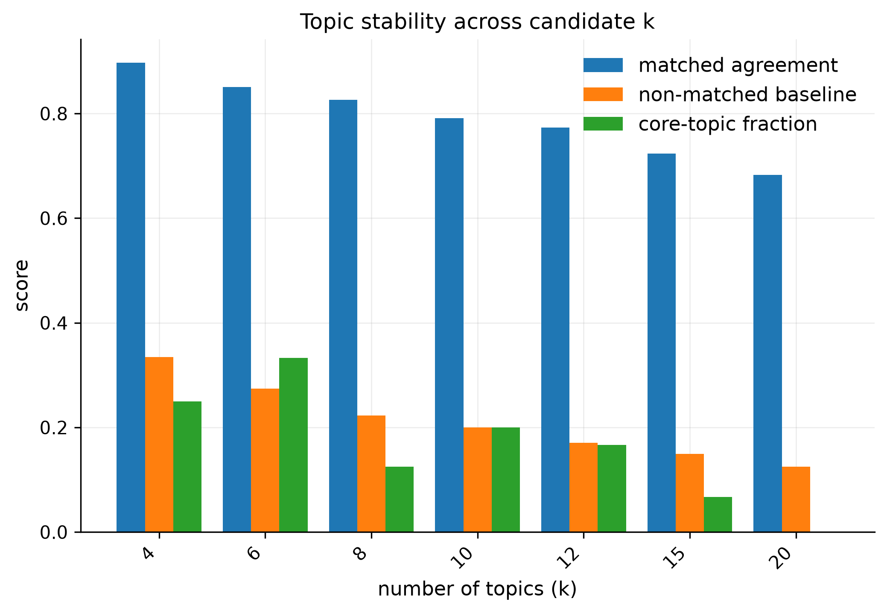

---

### 4. What works vs what is weak

| Works well now | Weak / incomplete |
|----------------|-------------------|
| Domain-level PPMI and BERT comparison | Sample size ≪ 10k/corpus |
| Frozen BERT neighbour stability | Most individual anchors too rare for inference |
| Emotion differences for Identity / Absence / Temporal | Digital emotion n.s.; true ABSA not trained |
| Explicit multi-method evaluation of W2V/FT | W2V/FT neighbours not trustworthy at this N |
| Stability-selected topics (honest core count) | Only one core topic |

### Figure index

| Figure | Path |
|--------|------|
| Domain coverage | [`docs/figures/p2_09_domain_coverage.png`](docs/figures/p2_09_domain_coverage.png) |
| PPMI domain PCA | [`docs/figures/p2_18_domain_profiles_pca.png`](docs/figures/p2_18_domain_profiles_pca.png) |
| PPMI domain t-SNE | [`docs/figures/p2_18_domain_profiles_tsne.png`](docs/figures/p2_18_domain_profiles_tsne.png) |
| BERT domain PCA | [`docs/figures/p2_18_domain_profiles_pca__contextual.png`](docs/figures/p2_18_domain_profiles_pca__contextual.png) |
| BERT domain t-SNE | [`docs/figures/p2_18_domain_profiles_tsne__contextual.png`](docs/figures/p2_18_domain_profiles_tsne__contextual.png) |
| cos\* PPMI vs BERT | [`docs/figures/p2_23_cosstar_ppmi_vs_contextual.png`](docs/figures/p2_23_cosstar_ppmi_vs_contextual.png) |
| Emotion stacked bars | [`docs/figures/p3_19_emotion_stacked_domain.png`](docs/figures/p3_19_emotion_stacked_domain.png) |
| Emotion difference heatmap | [`docs/figures/p3_19_emotion_difference_heatmap.png`](docs/figures/p3_19_emotion_difference_heatmap.png) |
| Co-occurrence A / B | [`p3_20_cooccurrence__a.png`](docs/figures/p3_20_cooccurrence__a.png), [`p3_20_cooccurrence__b.png`](docs/figures/p3_20_cooccurrence__b.png) |
| Topic prevalence | [`docs/figures/p4_20_topic_prevalence.png`](docs/figures/p4_20_topic_prevalence.png) |
| Topic stability | [`docs/figures/p4_20_topic_stability.png`](docs/figures/p4_20_topic_stability.png) |

Longer methods write-up: [`docs/METHODS_RESULTS.md`](docs/METHODS_RESULTS.md).  
Full numeric tables regenerate under `outputs/tables/` when you re-run the pipeline locally.

---

## Setup

### Scrape / Phase 1 environment

```powershell
cd <repo>
python -m venv .venv
.\.venv\Scripts\Activate.ps1
pip install -r requirements.txt
python -m spacy download en_core_web_sm
```

Apify auth (pick one):

- `apify login` (CLI keyring), or  
- `$env:APIFY_TOKEN = "apify_api_..."` from [Apify Integrations](https://console.apify.com/settings/integrations)

### Analysis environment (Phases 2–4)

Uses a **separate** venv so the torch/transformers stack does not disturb Phase 1.

```powershell
# Use a Python 3.12 base that matches your machine
python -m venv .venv-analysis
.\.venv-analysis\Scripts\python.exe -m pip install -U pip
.\.venv-analysis\Scripts\python.exe -m pip install -r requirements.txt -r requirements-analysis.txt -c constraints-analysis.txt
.\.venv-analysis\Scripts\python.exe -m pip install --index-url https://download.pytorch.org/whl/cpu torch
.\.venv-analysis\Scripts\python.exe -m pip install -r requirements-analysis-torch.txt -c constraints-analysis.txt
.\.venv-analysis\Scripts\python.exe -m spacy download en_core_web_sm
.\.venv-analysis\Scripts\python.exe -m spacy download en_core_web_md
.\.venv-analysis\Scripts\python.exe scripts\check_env.py
```

---

## Data collection (optional)

Scraping costs Apify credits. Pilot first:

```powershell
.\.venv\Scripts\Activate.ps1
python scripts/01_scrape_apify.py --mode pilot --corpus both --listings-only
```

Full collection (example — sequential is safest on limited concurrent memory):

```powershell
python scripts/01_scrape_apify.py --mode full --corpus both --engine trudax --searches-only --resume --workers 1 --timeout 3600
python scripts/03_filter_and_normalize.py
python scripts/04_preprocess_nlp.py
```

Config: `config/filters.yaml`, `config/scrape_runs.yaml`.  
Ops notes: `docs/SPEED.md`, `docs/HOME_RESUME.md`.

---

## Analysis pipeline

Seed dictionary: **4 domains / 71 anchors** in `config/anchors.yaml`  
(Temporal, Identity, Absence, Digital).

### Default path (PPMI + emotion + topics)

```powershell
.\.venv-analysis\Scripts\python.exe run_analysis.py
.\.venv-analysis\Scripts\python.exe -m pytest
```

### Frozen BERT (contextual) path

```powershell
.\.venv-analysis\Scripts\python.exe run_contextual_phase2.py
```

### Word2Vec / FastText (empirical small-corpus evaluation)

```powershell
.\.venv-analysis\Scripts\python.exe run_predictive_phase2.py
```

Regenerated tables/figures also appear under `outputs/` locally.  
Published copies of the main figures are kept in `docs/figures/` for the README.

### Method overview

| Method | Role |
|--------|------|
| **PPMI** | Shared-basis context profiles; strongest A/B collocational contrast |
| **BERT** (`bert-base-uncased`) | Frozen contextual senses; stable neighbours at current N |
| **Word2Vec / FastText** | Trained on-site; second-order profiles stable, neighbour lists weak at current N |
| **Emotion** | DistilRoBERTa-emotion on ±5-token anchor windows (ABSA *proxy*) |
| **Topics** | Pooled NMF with bootstrap stability (selected k=8) |

Interpretation limits (current sample sizes ~906 / 687):

- Prefer **domain-level** claims; most individual anchors are rare.  
- Digital domain is fragile (polysemy / sparse tech terms).  
- Emotion is a window proxy, not a trained aspect model.  
- Only one NMF topic currently meets the high-stability “core” bar (study-abroad language).

---

## Tests

```powershell
.\.venv-analysis\Scripts\python.exe -m pytest
```

---

## License / ethics

Reddit content is subject to Reddit’s terms and user privacy expectations. Use for research only; do not redistribute personal data without appropriate review. Apify usage is billed to your own account.
