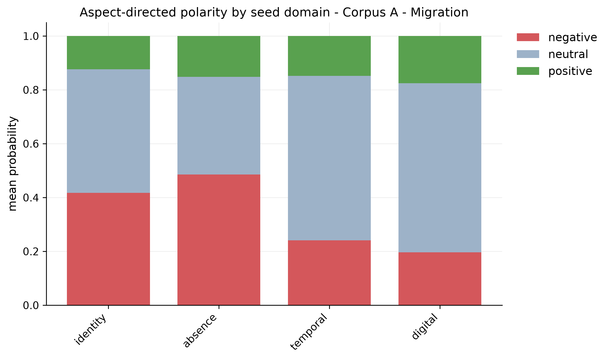
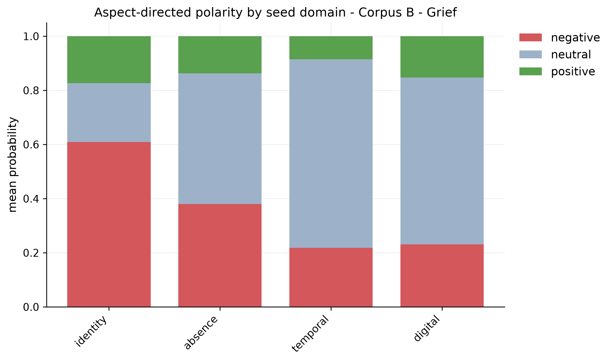
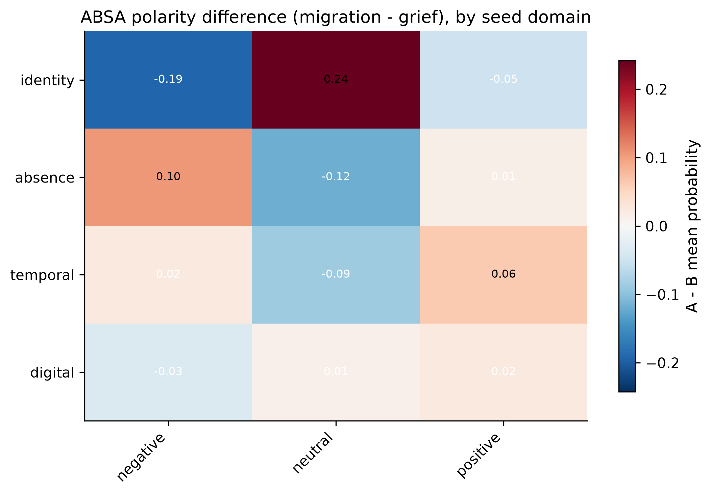
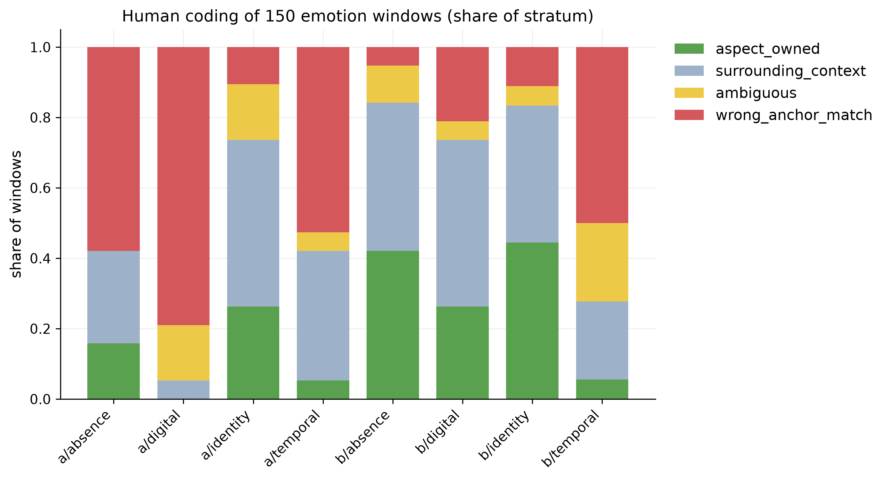
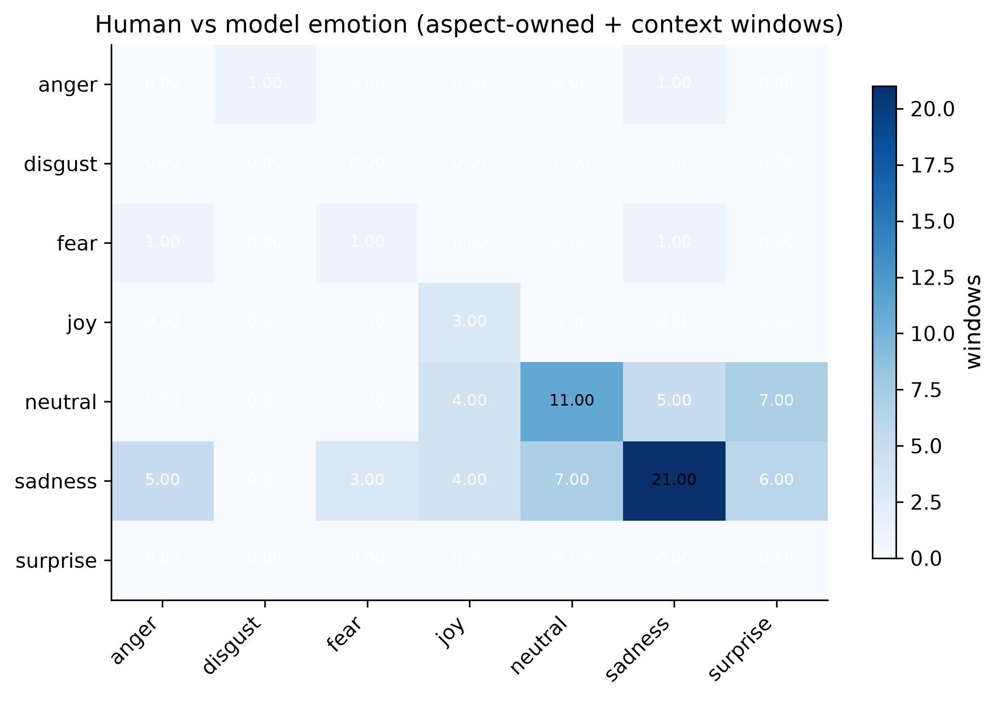
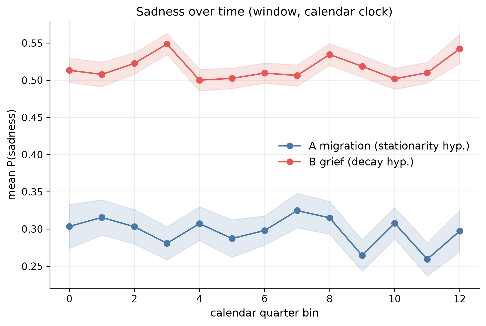
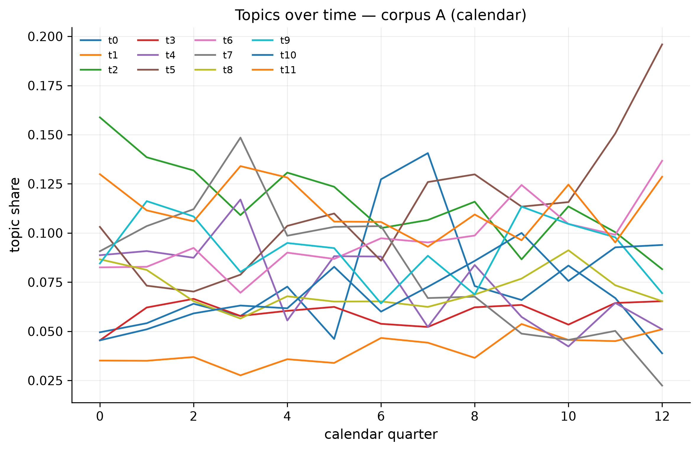
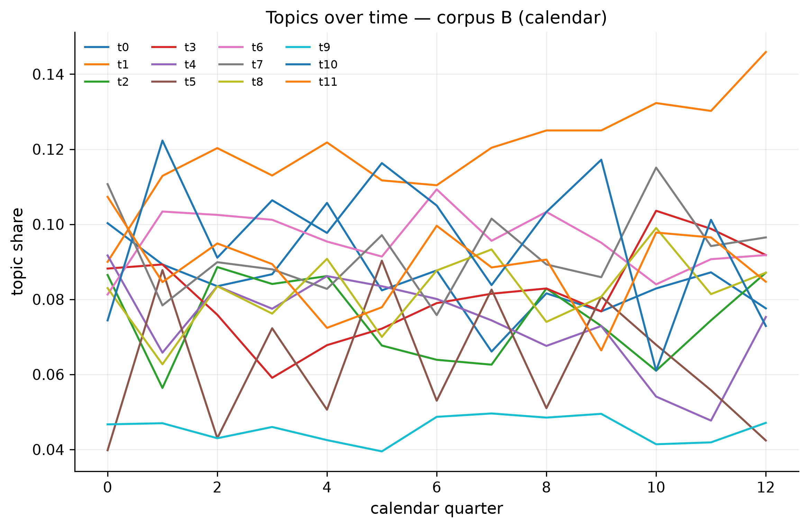
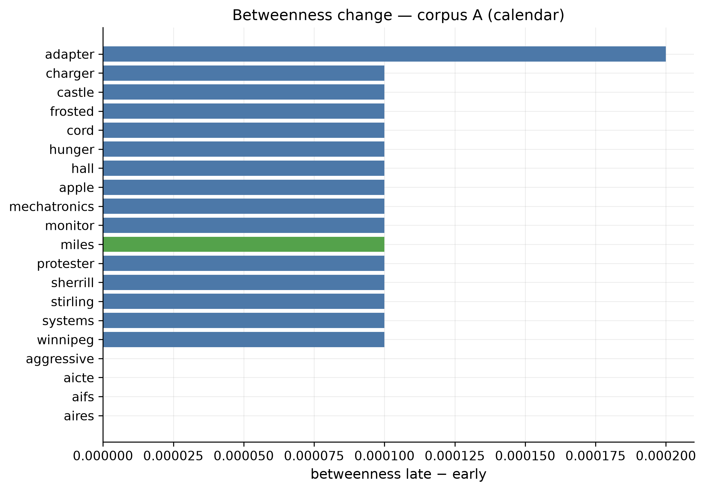

# Migration and Grief Narrative Analysis

Comparative NLP study of two Reddit **post** corpora (no comments):

| Corpus | Theme | Subreddits (10k sample) |
|--------|--------|-------------------------|
| **A — migration** | Expat / immigration / study-abroad experience | `r/expats` 3,889 · `r/StudyAbroad` 3,240 · `r/immigration` 2,871 |
| **B — grief** | Loss and bereavement | `r/GriefSupport` 9,752 · `r/bereavement` 248 |

**Question.** Do migration narratives and grief narratives organise the same four seed domains — **Temporal**, **Identity**, **Absence**, **Digital** — in the same way? We compare collocates (PPMI), frozen BERT senses, trained Word2Vec/FastText, emotion around anchors, co-occurrence networks, and topic models.

**Sample.** 10,000 posts per corpus. Body > 100 words. Window `2023-07-01 ≤ created_at < 2026-08-24`. Sampling seed `20260827`. Collection is **Arctic Shift** (this rebuild does not use Apify). Corpus A drops visa/tax/paperwork Q&A (whole-word filters + procedural flair). Corpus B is scarce-first so `r/bereavement` is fully included.

This README is the results front page. Longer methods notes: [`docs/METHODS_RESULTS.md`](docs/METHODS_RESULTS.md). Sampling audit: [`data/processed/PHASE1_COMPLETE.md`](data/processed/PHASE1_COMPLETE.md).

---

## Contents

1. [Status](#status)
2. [What we measured](#what-we-measured)
3. [Sample and seed dictionary](#sample-and-seed-dictionary)
4. [Phase 2 - semantics](#phase-2---semantics)
5. [Declared pair hypotheses](#declared-pair-hypotheses)
6. [Phase 3 - emotion and co-occurrence](#phase-3---emotion-and-co-occurrence)
7. [Phase 4 - topics](#phase-4---topics)
8. [Phase 5 - time from first post](#phase-5---time-from-first-post)
9. [What holds vs what is weak](#what-holds-vs-what-is-weak)
10. [Figure index](#figure-index)
11. [Reproduce](#reproduce)
12. [Ethics](#ethics)

---

## Status

| | |
|--|--|
| **Computational pipeline** | **Done** on the 10k / 10k analysis frame (Phases 1–5) |
| **Human validation** | **Done** — 150/150 windows coded; agreement reported below |
| **Ready for** | Drafting the paper from the results below |
| **Not finished** | The paper text itself |
| **Repo** | **Private.** Row-level CSVs contain Reddit post text — do not make public without ethics review |

**Done**

- Phase 1 sample: 10,000 + 10,000 posts; unique IDs; A ∩ B = 0; no empty/`[removed]` bodies.
- Seed dictionary: **4 domains, 71 anchors** (`config/anchors.yaml`).
- Phase 2: PPMI, frozen BERT, Word2Vec, FastText, reliability gates, top-15 neighbours, PCA/t-SNE, methods scoreboard.
- Phase 3: DistilRoBERTa-emotion on ±5-token windows (all four domains differ, q = 0.0003) **and** true ABSA (`yangheng/deberta-v3-base-absa-v1.1`). Identity / absence / temporal polarity differ (q = 0.0004); **Digital is null** (q = 0.486).
- Phase 4: pooled NMF **k = 12** (11/12 core); independent LDA/NMF (k = 10, 12, 15); MiniLM k = 12; **real BERTopic** 14/14 topics. Unforced Digital–Absence mix = **0** on every method.
- Phase 5: author-relative timelines, sadness slopes, MiniLM and BERTopic topics-over-time, early vs late PPMI betweenness. **Sadness is stationary in both corpora. Hybrid-node claim is not supported.**

**Done by hand**

- Human coding of the 150-window sample: complete (2026-10-01). Results under [Phase 3 — human validation](#human-validation-of-the-window-labels).

**Still human work**

1. Write the paper. Prefer **domain-level** claims. Declared pair hypotheses mostly fail or split by method — report that honestly.

---

## What we measured

| Method | What it answers | Role in this study |
|--------|-----------------|--------------------|
| **PPMI** | Do local collocates of a domain look the same in A and B? | Strongest A/B *collocational* contrast |
| **BERT** (`bert-base-uncased`, frozen) | Do pretrained contextual senses land in the same region? | Stable neighbours; high cross-corpus similarity with a residual difference |
| **Word2Vec / FastText** | Do *trained-on-site* embeddings recover the same picture? | Profiles stable; neighbour lists weaker than BERT |
| **Emotion** (DistilRoBERTa, 7 classes) | Does local emotion around anchors differ? | Window proxy (context emotion, not attitude toward the anchor) |
| **True ABSA** (DeBERTa-v3-absa) | Is polarity *about the seed term* different in A vs B? | Identity / absence / temporal yes (q = 0.0004); **Digital no** (q = 0.486) |
| **Pooled NMF** | Shared topic space with bootstrap stability | k = 12, 11/12 core |
| **Independent LDA / NMF / MiniLM** | Do A and B grow the *same* topics when fitted separately? Unforced Digital–Absence? | Digital–Absence never co-cluster at k = 12 |
| **BERTopic** (UMAP + HDBSCAN + c-TF-IDF) | Same unforced check with a density clusterer | 14 topics per corpus; mix still **0**; giant A catch-all of 6,260 posts |
| **Author-relative time** | Does sadness decay after each user's first post? | T0 is first post in sample, not the origin event; 95% of authors are singletons |
| **Calendar time** | Same tests on the 2023–2026 window | The clock that actually has mass in later bins |
| **Topics over time** | Do topics emerge/fade? | MiniLM k=12 and BERTopic DTM; mix still 0 |
| **Early vs late PPMI graphs** | Do betweenness spikes mark hybrid “points de capiton”? | Year 1 vs Year 3+; one negligible hybrid (`miles`) |

Shared vocabulary basis for comparable profiles: types with frequency ≥ 20 in **both** corpora (**2,286** dimensions).

---

## Sample and seed dictionary

| | Corpus A | Corpus B |
|--|---------:|---------:|
| Posts | 10,000 | 10,000 |
| Subreddits | expats 3,889; StudyAbroad 3,240; immigration 2,871 | GriefSupport 9,752; bereavement 248 |
| Primary files | [`data/analysis/corpus_a.csv`](data/analysis/corpus_a.csv) | [`data/analysis/corpus_b.csv`](data/analysis/corpus_b.csv) |

Rules: posts only; body > 100 words (title does not count); fail-closed dates; A keyword blacklist is whole-word (so `ead`/`irs` substring bugs do not fire). Prefer `data/analysis/` for new work. Raw dumps are not in git.

### Four seed domains (71 anchors)

| Domain | Label | Example terms | Posts hitting domain (full dict) | Strict (non-polysemous) |
|--------|--------|---------------|----------------------------------:|------------------------:|
| **Temporal** | Time–space disruption | timezone, weekend, schedule, distance, stuck | A **26.4%** · B **47.9%** | A 8.2% · B 12.8% |
| **Identity** | Symbolic order / belonging | name, accent, belong, culture shock, foreigner | A **16.8%** · B **16.2%** | A 11.4% · B 4.7% |
| **Absence** | Existential absence / grief | alone, lost, gone, missing, ghost, funeral | A **19.7%** · B **84.1%** | A 10.3% · B 58.7% |
| **Digital** | Digital contact | skype, screen, wifi, video call, connection | A **7.8%** · B **8.0%** | A **2.6%** · B 2.8% |

Absence dominates grief posts. Identity is denser in migration under the strict list. **Digital is the sparsest domain in both corpora** even after 10k.


*Share of posts hitting each domain: full dictionary vs strict (non-polysemous) list.*

Usable **individual** anchors (frequency ≥ 20 in the weaker corpus **and** reliability gate): **29/71** PPMI, **40/71** BERT, **48/71** Word2Vec, **48/71** FastText. All **4/4 domains** are usable. Prefer domain-level claims.

---

## Phase 2 - semantics

We compare how each domain is represented in migration vs grief.  
**cos\*** = attenuation-corrected cosine (higher ≈ more similar across corpora).  
Significance: post-level resampling + Benjamini–Hochberg FDR.

| Domain | PPMI cos\* | PPMI A vs B different? | BERT cos\* | BERT residual difference? |
|--------|-----------:|:----------------------:|-----------:|:-------------------------:|
| Temporal | 0.71 | **Yes** (q = 0.0001) | 0.92 | Yes (q = 0.002) |
| Absence | 0.67 | **Yes** (q = 0.0001) | 0.93 | Yes (q = 0.002) |
| Identity | 0.70 | **Yes** (q = 0.0001) | 0.86 | Yes (q = 0.002) |
| Digital | 0.71 | **Yes** (q = 0.0001) | 0.97 | Yes (q = 0.002) |

**How to read this**

- **PPMI:** “Do the *local collocates* look the same?” **No** for all four domains (q = 0.0001). Digital is no longer the n.s. exception it was on the 906/687 pilot.
- **BERT:** “Do *pretrained senses* land in the same region?” **Mostly yes** (high cos\*), but still not interchangeable under a label-permutation null.
- These are **complementary**, not contradictory. PPMI is the discriminative collocational signal; BERT is the stable sense geometry.

### Domain profile geometry — PPMI

Eight points = 4 domains × 2 corpora. Colour = corpus.

**PCA**


**t-SNE**


### Domain profile geometry — frozen BERT

**PCA**


**t-SNE**


### PPMI vs BERT cos\*

Points above the diagonal: BERT finds *more* cross-corpus similarity than PPMI (true for every domain).


### Word2Vec and FastText (trained on these texts)

Full 10k/10k evaluation (12 splits / 20 bootstrap / 30 permutations).

| Method | Domain profile reliability (mean A / B) | Neighbour Jaccard (mean A / B) | Domain cos\* |
|--------|-----------------------------------------|--------------------------------|--------------|
| BERT | 0.999 / 0.999 | **0.60 / 0.75** | 0.86–0.97 |
| FastText | 0.992 / 0.990 | 0.17 / 0.36 | 0.97–0.98 |
| Word2Vec | 0.988 / 0.986 | 0.13 / 0.29 | 0.96–0.98 |
| PPMI | 0.55 / 0.58 | 0.04 / 0.05 | 0.67–0.71 |

Chance neighbour Jaccard ≈ **0.0033** (basis = 2,286).

**Takeaway at 10k**

1. W2V/FT **domain profiles** are stable (rel ≈ 0.99).
2. Their **top-15 neighbour lists** beat chance but stay well below BERT — do not headline W2V/FT neighbours.
3. W2V/FT **cos\*** is near 1 (little A/B contrast). **PPMI** is most discriminative for collocates; **BERT** sits in between.

BERT split-half reliability is measured **without** per-half all-but-the-top (ABTT). ABTT on only four domain profiles per half destroyed reliability; ABTT is only used when there are enough points.

---

## Declared pair hypotheses

Four pre-declared domain-pair stories, scored on 10k with PPMI and BERT (CI on Δ = A − B). Full sheet: regenerate `outputs/tables/p2_14_hypothesis_outcomes.csv` locally.

| Comparison | Declared story | PPMI | BERT | Overall |
|------------|----------------|------|------|---------|
| Digital vs Absence | Closer in **migration** | not supported (CI includes 0) | **supported** | **partial** |
| Temporal vs Absence | Closer in **grief** | **opposite sign** | **opposite sign** | **rejected** |
| Identity vs Absence | Closer in **migration** | not supported | **supported** | **partial** |
| Digital vs Temporal | Closer in **migration** | **opposite sign** | **supported** | **methods disagree** |

Both methods put *temporal vs absence* **closer in migration**, opposite the brief. BERT and PPMI **disagree on the sign** of *digital vs temporal*. Report both methods; do not pick the convenient one.

---

## Phase 3 - emotion and co-occurrence

**Model:** `j-hartmann/emotion-english-distilroberta-base` (anger, disgust, fear, joy, neutral, sadness, surprise).  
**Design:** sentence-clipped ±5-token windows; one post per author for inference; polysemous anchors excluded from strict estimates; FDR across domain tests.

| Domain | Emotion distribution A vs B | FDR q | Notable A − B |
|--------|----------------------------|------:|----------------|
| Identity | **Different** | 0.0003 | sadness −0.17 (higher sadness in grief) |
| Absence | **Different** | 0.0003 | surprise higher in grief |
| Temporal | **Different** | 0.0003 | sadness higher in grief; more neutral in migration |
| Digital | **Different** | 0.0003 | **neutral +0.21** in migration |

This DistilRoBERTa run is a **window proxy**: it scores emotion of the local context, not attitude toward the seed term. The human audit below quantifies exactly how noisy that proxy is.

**Stacked emotion mix by domain and corpus**


**Emotion difference heatmap** (Corpus A − Corpus B; `*` survives multiple-testing correction)


### True ABSA (aspect = the seed term)

Trained aspect model `yangheng/deberta-v3-base-absa-v1.1`. Input is `[CLS] raw sentence [SEP] anchor [SEP]`. Same author-cap / polysemy / FDR protocol as the window tests. 8,911 pairs in A, 29,679 in B (13,323 after filters used for inference).

| Domain | JS | FDR q | What it means |
|--------|---:|------:|----------------|
| Identity | 0.219 | **0.0004** | Grief more *aspect-negative* (0.61 vs 0.42) |
| Absence | 0.104 | **0.0004** | Migration more aspect-negative (0.49 vs 0.38) |
| Temporal | 0.092 | **0.0004** | Migration more aspect-positive |
| Digital | 0.040 | **0.486** | **Null** — not different |

The window-emotion Digital finding (migration more *neutral*) does **not** survive as polarity *about* skype/wifi/video-call. Context emotion around the tool is not the same as attitude toward the tool. That split belongs in the paper.

**ABSA polarity mix — Corpus A (migration)**



**ABSA polarity mix — Corpus B (grief)**



**ABSA difference heatmap** (migration − grief)



Scripts: [`scripts/45_absa_true.py`](scripts/45_absa_true.py), [`scripts/45b_absa_figures.py`](scripts/45b_absa_figures.py).

### Human validation of the window labels

All **150/150** sampled windows were hand-coded blind (model labels kept on a separate sheet). Each window got a category — is the emotion *about the seed term*? — plus a dominant emotion and a confidence.

| Human category | n | share |
|----------------|--:|------:|
| aspect_owned (emotion is about the seed term) | 31 | 20.7% |
| surrounding_context (emotional, not about the term) | 50 | 33.3% |
| ambiguous | 15 | 10.0% |
| wrong_anchor_match (term used in another sense) | 54 | **36.0%** |

Three findings matter for the paper:

1. **Only ~1 in 5 scored windows is aspect-owned.** The window-emotion signal is mostly context — exactly the caveat the proxy carries. Worse, every wrong-sense match sits on an anchor the dictionary flags as *non-polysemous* (`internet` 12, `schedule` 7, `weekend` 5, `alone`/`forgotten`/`distance`/`whatsapp` 4 each). The flag under-detects surface-sense drift; this is concentrated in Corpus A (38/54 wrong matches; `a/digital` is 79% wrong-sense) and barely present in grief absence/identity strata.
2. **Label agreement is fair at best.** Human vs model on windows where a human saw real emotion (aspect + context, n = 81): accuracy **0.44**, Cohen's κ **0.23**. On aspect-owned only (n = 31): accuracy 0.42, κ 0.10. The human aspect-owned labels are 77% sadness — the classes that exist in these corpora are the ones the model confuses least (sadness→sadness is the big diagonal cell).
3. **Model confidence is informative.** Mean `p_max` on human-agreeing windows 0.85 vs 0.65 on disagreements (Mann–Whitney p ≈ 3.4e-6); coder confidence 3 rows agree 68% vs ~35% for confidence 1–2. Domain-level distributions over thousands of windows can still carry real signal even when per-window labels are coin-flippy — but per-window labels should not be quoted, and aspect-directed claims belong to the true ABSA (above), not the window proxy.



*Share of each corpus × domain stratum the coder assigned to each category. Corpus A is dominated by wrong-sense matches; grief absence/identity windows are the most aspect-owned.*



*Human label (row) vs model label (column) on the 81 windows with a real emotion. Agreement is concentrated on sadness and neutral.*

Script: [`scripts/47_annotation_agreement.py`](scripts/47_annotation_agreement.py). Tables: `outputs/tables/p3_47_*` (local only — row-level text stays out of git).

### Co-occurrence networks

Seed-dictionary subgraphs (Temporal / Identity / Absence / Digital). Node colour = domain. The full 300-edge PPMI dump is mostly tight closed-class clusters in other languages, so the README figure keeps the research terms.

**Corpus A — migration** (identity cluster left; time/distance cluster right)


**Corpus B — grief** (absence cluster left; time/distance cluster right)


---

## Phase 4 - topics

Two complementary designs.

1. **Pooled NMF** on A+B with bootstrap stability (shared topic space, comparable prevalence).
2. **Independent** LDA, NMF, and MiniLM on A and B *separately* (no forced alignment; tests whether Digital and Absence fall into one topic when unforced).
3. **BERTopic** (UMAP + HDBSCAN + c-TF-IDF) in an isolated venv, same unforced Digital–Absence check.

### Pooled NMF (stability-selected)

- TF–IDF NMF, bootstrap stability selection.
- k-sweep: k = 8 has the highest mean agreement (**0.96**); **k = 12** keeps **11/12** core topics and the highest agreement-above-null (**0.80**). Selected **k = 12**.

| Topic | Load | Recurrence | Core? | Top terms (short) |
|------:|------|-----------:|:-----:|-------------------|
| 0 | B — hospital days | 1.00 | ★ | day, week, time, hospital, cry, die |
| 1 | A — language/culture | 0.50 | | country, language, english, culture, foreigner |
| 2 | A — university | 1.00 | ★ | university, student, master, degree, scholarship |
| 3 | B — father loss | 1.00 | ★ | dad, die, mum, passing_away, parent, lost |
| 4 | A — passport / citizenship | 1.00 | ★ | passport, citizen, birth, immigration, esta |
| 5 | B — grief support | 0.80 | ★ | grief, lost, loss, help, grieve, support |
| 6 | B — mom / sister cancer | 1.00 | ★ | mom, cancer, sister, pass, grandma |
| 7 | A — study abroad | 1.00 | ★ | study, abroad, program, semester, scholarship |
| 8 | B — love / miss | 0.95 | ★ | love, miss, never, gone, without |
| 9 | B — family deaths | 0.95 | ★ | brother, mother, family, father, sister, die |
| 10 | Shared — friends/talk | 1.00 | ★ | friend, talk, meet, group, family |
| 11 | A — move / job | 0.85 | ★ | move, job, work, live, uk, family |

**Topic prevalence by corpus** (★ = core)


**Topic stability** across bootstrap runs (dashed line = core threshold)


### Independent models (per corpus)

Script: [`scripts/33_phase4_full_compare.py`](scripts/33_phase4_full_compare.py).

| Fit | Grid |
|-----|------|
| LDA, separately on A and on B | k = 10, 12, 15 |
| NMF, separately on A and on B | k = 10, 12, 15 |
| MiniLM-L6-v2 + KMeans + class-based TF-IDF | k = 12 (GPU if available) |

**Headline.** At k = 12, **zero topics mix Digital and Absence** on either corpus under LDA, NMF, or MiniLM. Digital anchors almost never enter the top-10. Absence appears in grief NMF (loss / family) as expected. Independent models do **not** force a Digital–Absence cluster.

**Independent NMF k = 12 — most prevalent topics**

| Corpus | Topic | Mean θ | Seed hits | Top terms |
|--------|------:|-------:|-----------|-----------|
| A | 2 | 0.13 | — | immigration, help, case, lawyer, ice, process |
| A | 3 | 0.10 | — | master, degree, job, work, bachelor, career |
| A | 5 | 0.10 | — | people, friend, meet, group, expat, social |
| A | 1 | 0.09 | — | study, abroad, program, college, semester, scholarship |
| B | 2 | 0.14 | — | tell, call, home, hospital, week, last |
| B | 4 | 0.13 | Absence | love, miss, never, wish, without, gone |
| B | 0 | 0.12 | Absence | grief, people, loss, help, lost, grieve |
| B | 3 | 0.08 | Absence | dad, parent, die, passing_away, family, lost |

**Independent LDA k = 12 — most prevalent topics**

| Corpus | Topic | Mean θ | Seed hits | Top terms |
|--------|------:|-------:|-----------|-----------|
| A | 1 | 0.20 | — | feel, go, like, want, move, back, home |
| A | 10 | 0.18 | — | study, university, student, abroad, program, school |
| A | 5 | 0.16 | — | work, job, move, uk, live, country |
| A | 3 | 0.11 | — | passport, citizen, citizenship, immigration, birth |
| B | 7 | 0.56 | Absence | dad, mom, friend, die, lost, family |
| B | 4 | 0.20 | — | love, never, miss, still, always, remember |
| B | 11 | 0.11 | — | hospital, tell, week, call, mom, home |

LDA on B is peakier (one family-loss topic takes ~56% mean θ). NMF spreads mass more evenly. MiniLM recovers finer clusters (homesickness vs deportation vs study logistics on A; ambulance/CPR vs bereavement resources on B) but does not create a Digital–Absence topic either.

**Corpus A — LDA k=12 topic-keyword network** (strongest co-occurrence backbone; labels = highest-degree terms)


**Corpus B — LDA k=12 topic-keyword network**


**Interactive topic views** (open on GitHub, then “View raw” / download if the preview is static):

| | Corpus A | Corpus B |
|--|----------|----------|
| LDA k=12 | [html](docs/figures/p4_33_interactive__lda__a.html) | [html](docs/figures/p4_33_interactive__lda__b.html) |
| NMF k=12 | [html](docs/figures/p4_33_interactive__nmf__a.html) | [html](docs/figures/p4_33_interactive__nmf__b.html) |
| MiniLM k=12 | [html](docs/figures/p4_33_interactive__minilm__a.html) | [html](docs/figures/p4_33_interactive__minilm__b.html) |

Numeric tables regenerate locally under `outputs/tables/p4_33_alignment.csv`, `p4_33_topic_terms.csv`, `p4_33_digital_absence_mix.csv`, `p4_33_domain_bridges.csv`.

### BERTopic (real; isolated venv)

Phase 4 asked for BERTopic. It now runs as UMAP + HDBSCAN + c-TF-IDF in `.venv-bertopic` (so UMAP/HDBSCAN never touch `.venv-analysis`). Embeddings are MiniLM, precomputed on GPU. Reduction `nr_topics=15` → **14 topics per corpus**. Digital–Absence mix (exact seed pair in the top-10) is still **0**.

| | Corpus A | Corpus B |
|--|----------:|----------:|
| Raw HDBSCAN clusters | 121 | 60 |
| Topics after reduction | 14 | 14 |
| Raw outliers | 48.6% | 37.4% |
| After `reduce_outliers` | 0 | 0 |
| Digital–Absence mix | **0** | **0** |

A topic 0 is a giant generic cluster (**6,260 / 10,000**: *im / like / abroad / just…*). A7 (54 docs) and B12 (12 docs) are non-English stopword clusters. Mix = 0 only means no exact seed pair in the top-10; it does not make the topics theoretically clean.

**Readable non-giant topics (top words)**

| Corpus | Topic | n | Top words |
|--------|------:|--:|-----------|
| A | 1 | 1,055 | immigration, ice, esta |
| A | 2 | 927 | passport, citizenship, birth, citizen |
| A | 6 | 359 | university, gpa, study |
| A | 5 | 273 | opt, employer, work |
| B | 2 | 555 | dog, cat, vet |
| B | 5 | 528 | dad, mom |
| B | 7 | 302 | grief, support |
| B | 6 | 210 | baby, pregnant |
| B | 3 | 256 | love, miss |

Scripts: [`scripts/46_bertopic_embed.py`](scripts/46_bertopic_embed.py), [`scripts/46_bertopic_run.py`](scripts/46_bertopic_run.py). Interactive HTML stays under local `outputs/figures/p4_46_*` (large files, not copied here).

---

## Phase 5 - time from first post

`phases/New.docx` asks four things on top of the static 10k/10k frame: tag every post by distance from the author's first post; test whether **sadness decays** in grief but stays flat in migration; replace static topics with **topics over time**; compare Year-1 vs Year-3+ PPMI graphs for **betweenness spikes** (hybrid nodes / *points de capiton*).

**T0 is a proxy.** It is the first post *in this sample*, not the date of migration or death. 9,375 / 9,107 authors appear once, so 97.9% / 96.0% of posts sit in author-relative quarter 0. Author-relative Year 3+ has **5** migration posts and **14** grief posts. Calendar time (from 2023-07-01) is the dual clock that still has thousands of posts in Year 3+.

Corpus B is the **bereavement comparandum**, not a homeland panel watching migrants leave. The decay hypothesis is tested on B as written; it is not relabelled.

**Sadness slopes (primary: window DistilRoBERTa, all posts, bin means, BH-FDR).** Calendar time: migration slope −0.0016 (p = 0.28, q = 0.85); grief +0.0005 (p = 0.71, q = 0.86). Both **stationary / null**. The same null holds for full-post emotion, Theil–Sen, permutation tests, and author-clustered post-level OLS on the calendar clock. Grief does **not** show the predicted decay.



**Topics over time.** Two stacks: (1) MiniLM + KMeans k=12 with global topic identity, then quarter prevalence; (2) literal BERTopic `topics_over_time` (`p5_46_*`, local outputs). Unforced Digital–Absence mix remains **0**, including NMF fitted separately on each calendar year. Migration still grows a homesickness cluster (`cry / lonely / regret / homesickness`); grief stays in family-illness / caregiver space.




**Early vs late graphs.** PPMI co-occurrence, Year 1 vs Year 3+, betweenness. After English + multilingual closed-class filters, calendar-late spikes are small lexical items, not seed-domain bridges. The only hybrid that meets the spike-and-domain rule is the Temporal seed **`miles`** on migration calendar time, with Δ betweenness ≈ 0.0001. Top-25 betweenness Jaccard across early/late is ~0–0.06. The *Aufhebung* / hybrid-node claim is **not supported**.



Scripts: `40_temporal_stratify.py` → `41_emotion_over_time.py` → `42_topics_over_time.py` → `43_temporal_graphs.py` → `44_temporal_figures.py`.

---

## What holds vs what is weak

| Holds on 10k / 10k | Weak / incomplete |
|--------------------|-------------------|
| Documented 10k/10k sampling frame with quotas | Most individual anchors still too rare for inference |
| Domain-level PPMI contrast (4/4 FDR) | Window emotion is not the same as aspect polarity |
| Frozen BERT neighbour stability | Human audit: only 21% of scored windows are aspect-owned; 36% are wrong-sense matches the polysemy flag misses |
| Window emotion differs for all four domains | Per-window labels agree with a human only 0.44 (κ 0.23) — report domain distributions, never single windows |
| Human audit of 150 windows done | Model confidence is calibrated (p_max 0.85 vs 0.65); coder-sure rows agree 68% |
| True ABSA: identity / absence / temporal differ | **Digital ABSA is null** (q = 0.486); window-emotion Digital was context, not aspect |
| Pooled NMF 11/12 core topics at k=12 | BERT/PPMI disagree on the sign of digital vs temporal |
| LDA / NMF / MiniLM / BERTopic: **no Digital–Absence mix** | BERTopic A topic 0 is a 6,260-post catch-all; two non-English clusters |
| Declared pair hypotheses scored honestly | Paper text not written yet |
| Calendar sadness **stationary in both** corpora | Author-relative T0 cannot recover the origin event; Year 3+ is almost empty |
| Topics-over-time; mix still 0 | Hybrid betweenness nodes essentially absent (`miles` only) |

**For the paper:** report PPMI and BERT together. Report window emotion **and** true ABSA; they disagree on Digital. Report the human audit alongside window emotion — the labels are a noisy context proxy, not per-window truth. Do not headline Word2Vec/FastText neighbours. Prefer domain-level claims. State that independent topic models and BERTopic do not recover a Digital–Absence cluster.

---

## Figure index

| Figure | File |
|--------|------|
| Domain coverage | [p2_09_domain_coverage.png](docs/figures/p2_09_domain_coverage.png) |
| PPMI domain PCA | [p2_18_domain_profiles_pca.png](docs/figures/p2_18_domain_profiles_pca.png) |
| PPMI domain t-SNE | [p2_18_domain_profiles_tsne.png](docs/figures/p2_18_domain_profiles_tsne.png) |
| BERT domain PCA | [p2_18_domain_profiles_pca__contextual.png](docs/figures/p2_18_domain_profiles_pca__contextual.png) |
| BERT domain t-SNE | [p2_18_domain_profiles_tsne__contextual.png](docs/figures/p2_18_domain_profiles_tsne__contextual.png) |
| cos\* PPMI vs BERT | [p2_23_cosstar_ppmi_vs_contextual.png](docs/figures/p2_23_cosstar_ppmi_vs_contextual.png) |
| Emotion stacked bars | [p3_19_emotion_stacked_domain.png](docs/figures/p3_19_emotion_stacked_domain.png) |
| Emotion difference heatmap | [p3_19_emotion_difference_heatmap.png](docs/figures/p3_19_emotion_difference_heatmap.png) |
| True ABSA stacked A / B | [p3_45_absa_stacked_domain__a.png](docs/figures/p3_45_absa_stacked_domain__a.png), [p3_45_absa_stacked_domain__b.png](docs/figures/p3_45_absa_stacked_domain__b.png) |
| True ABSA difference heatmap | [p3_45_absa_difference_heatmap.png](docs/figures/p3_45_absa_difference_heatmap.png) |
| Human coding by stratum | [p3_47_annotation_categories.png](docs/figures/p3_47_annotation_categories.png) |
| Human vs model confusion | [p3_47_annotation_confusion.png](docs/figures/p3_47_annotation_confusion.png) |
| Seed-domain co-occurrence A | [p3_20_cooccurrence__a.png](docs/figures/p3_20_cooccurrence__a.png) |
| Seed-domain co-occurrence B | [p3_20_cooccurrence__b.png](docs/figures/p3_20_cooccurrence__b.png) |
| Topic prevalence (pooled NMF) | [p4_20_topic_prevalence.png](docs/figures/p4_20_topic_prevalence.png) |
| Topic stability (pooled NMF) | [p4_20_topic_stability.png](docs/figures/p4_20_topic_stability.png) |
| Independent topic network A | [p4_33_topic_network__a.png](docs/figures/p4_33_topic_network__a.png) |
| Independent topic network B | [p4_33_topic_network__b.png](docs/figures/p4_33_topic_network__b.png) |
| Sadness over calendar time | [p5_44_sadness_over_time__calendar__window.png](docs/figures/p5_44_sadness_over_time__calendar__window.png) |
| Topics over time A | [p5_44_topics_over_time__a__calendar.png](docs/figures/p5_44_topics_over_time__a__calendar.png) |
| Topics over time B | [p5_44_topics_over_time__b__calendar.png](docs/figures/p5_44_topics_over_time__b__calendar.png) |
| Betweenness change A | [p5_44_betweenness_delta__a__calendar.png](docs/figures/p5_44_betweenness_delta__a__calendar.png) |

Longer methods write-up: [`docs/METHODS_RESULTS.md`](docs/METHODS_RESULTS.md).

---

## Reproduce

### Repository layout

```
config/           filters, scrape plan, seed dictionary, analysis knobs
data/processed/   Phase 1 cleaned CSVs + PHASE1_COMPLETE.md
data/analysis/    primary research CSVs for Phases 2–4
docs/figures/     publication figures (this README)
docs/METHODS_RESULTS.md
scripts/          scrape → filter → analysis (incl. 33_phase4_full_compare.py)
tests/
run_analysis.py              Phase 2–4 PPMI default path
run_contextual_phase2.py     frozen BERT + methods join
run_predictive_phase2.py     Word2Vec / FastText evaluation
```

Python 3.12. Analysis uses a **separate** venv from scraping so torch does not disturb spaCy.

```powershell
python -m venv .venv-analysis
.\.venv-analysis\Scripts\python.exe -m pip install -U pip
.\.venv-analysis\Scripts\python.exe -m pip install -r requirements.txt -r requirements-analysis.txt -c constraints-analysis.txt
.\.venv-analysis\Scripts\python.exe -m pip install --index-url https://download.pytorch.org/whl/cpu torch
.\.venv-analysis\Scripts\python.exe -m pip install -r requirements-analysis-torch.txt -c constraints-analysis.txt
.\.venv-analysis\Scripts\python.exe -m spacy download en_core_web_sm
.\.venv-analysis\Scripts\python.exe -m spacy download en_core_web_md
.\.venv-analysis\Scripts\python.exe scripts\check_env.py
.\.venv-analysis\Scripts\python.exe run_analysis.py
.\.venv-analysis\Scripts\python.exe run_contextual_phase2.py
.\.venv-analysis\Scripts\python.exe run_predictive_phase2.py
.\.venv-analysis\Scripts\python.exe scripts\33_phase4_full_compare.py
.\.venv-analysis\Scripts\python.exe scripts\45_absa_true.py
.\.venv-analysis\Scripts\python.exe scripts\45b_absa_figures.py
.\.venv-analysis\Scripts\python.exe scripts\40_temporal_stratify.py
.\.venv-analysis\Scripts\python.exe scripts\41_emotion_over_time.py
.\.venv-analysis\Scripts\python.exe scripts\42_topics_over_time.py --skip-bertopic
.\.venv-analysis\Scripts\python.exe scripts\43_temporal_graphs.py
.\.venv-analysis\Scripts\python.exe scripts\44_temporal_figures.py
.\.venv-analysis\Scripts\python.exe scripts\47_annotation_agreement.py
.\.venv-analysis\Scripts\python.exe -m pytest
```

BERTopic is a **separate** venv so UMAP/HDBSCAN never touch the analysis stack:

```powershell
python -m venv .venv-bertopic
.\.venv-bertopic\Scripts\python.exe -m pip install bertopic
.\.venv-analysis\Scripts\python.exe scripts\46_bertopic_embed.py
.\.venv-bertopic\Scripts\python.exe scripts\46_bertopic_run.py
```

Rebuild the raw archive only if needed (not required to analyse the CSVs already in this repo):

```powershell
python scripts/31_scrape_arctic_shift.py
python scripts/03_filter_and_normalize.py
python scripts/04_preprocess_nlp.py
python scripts/08_reprocess_tokens.py
```

Tables and extra figures land under `outputs/` locally (gitignored). Published figures live in `docs/figures/`.

Annotation pack (local only): `python scripts/22_annotation_sample.py --replace` then `python scripts/32_make_annotation_workbook.py`. After the workbook comes back coded: `python scripts/47_annotation_agreement.py` (scores human vs model; writes `outputs/tables/p3_47_*`).

---

## Ethics

Reddit content is subject to Reddit’s terms and user privacy expectations. Use for research only. Do not redistribute personal data without appropriate review. This repository is private because the CSVs include post text, usernames, and URLs.
