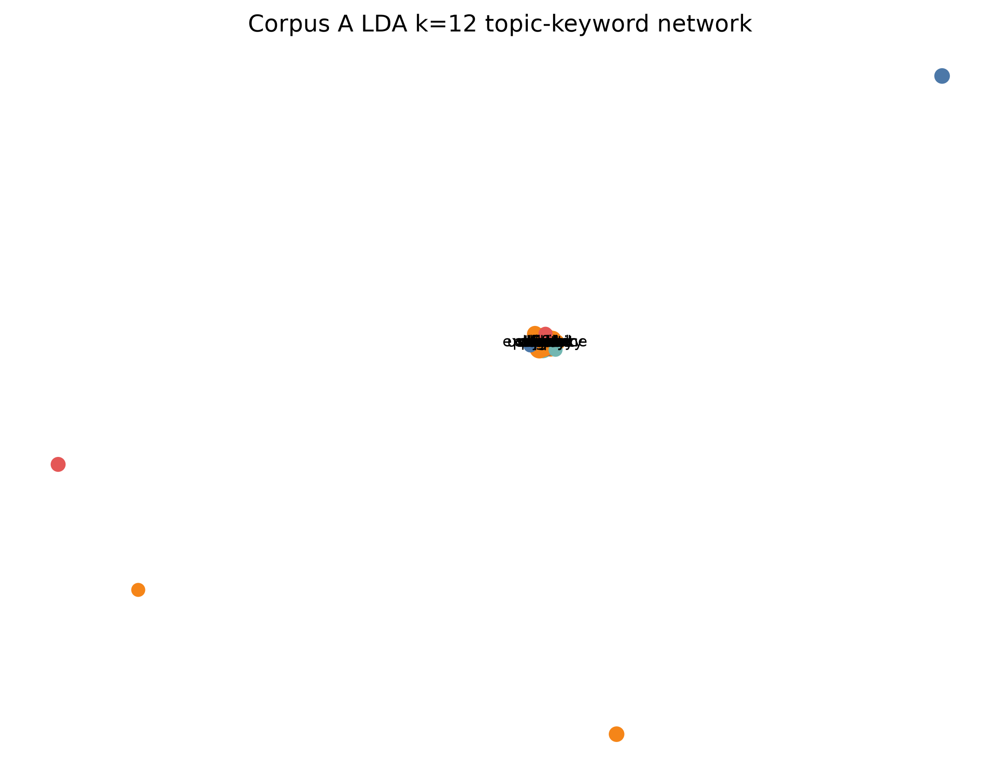
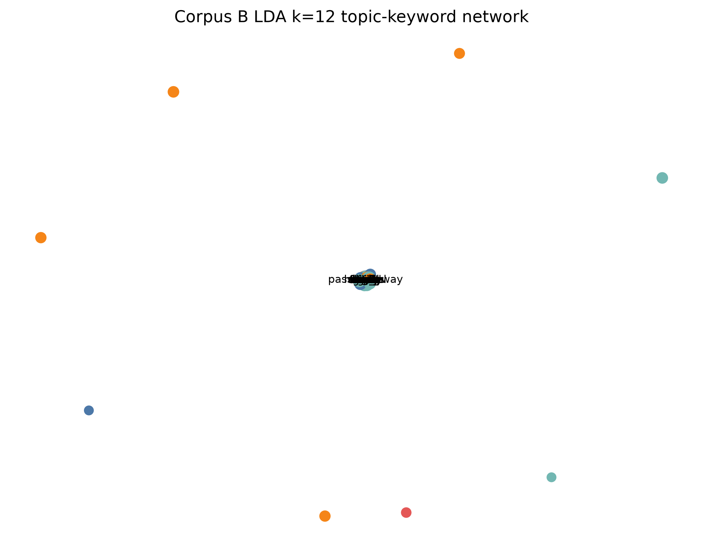

# Migration and Grief Narrative Analysis

Comparative NLP study of two Reddit post corpora:

| Corpus | Theme | Subreddits |
|--------|--------|------------|
| **A** | Migration / expat experiences | `r/expats`, `r/immigration`, `r/StudyAbroad` |
| **B** | Loss / grief experiences | `r/GriefSupport`, `r/bereavement` |

Posts only (no comments), longer than 100 words, roughly the last three years from mid-2023, with soft flair preference. Corpus A drops visa/tax/paperwork Q&A via keyword filters.

Collection is Arctic Shift (no Apify on the current 10k rebuild). Analysis covers Phases 2–4: semantic comparison (PPMI, BERT, Word2Vec, FastText), emotion windows, co-occurrence networks, and topic modeling.

---

## Status

| | |
|--|--|
| **Ready for** | Drafting the research paper from the 10k / 10k results below |
| **Not finished** | Human coding of 150 emotion windows; the paper text itself |
| **Repo** | Private. Row-level CSVs contain Reddit post text — do not make public without ethics review |

### Done

- Phase 1 sample: **10,000** migration posts and **10,000** grief posts (`2023-07-01` ≤ date `< 2026-08-24`, body > 100 words, quotas + flair-first). Audit: [`data/processed/PHASE1_COMPLETE.md`](data/processed/PHASE1_COMPLETE.md).
- Seed dictionary: 4 domains, 71 anchors (`config/anchors.yaml`).
- Phase 2: PPMI, frozen BERT, Word2Vec, FastText, reliability gates, top-15 neighbours, PCA/t-SNE.
- Phase 3: DistilRoBERTa-emotion on ±5-token windows (ABSA **proxy**, not a trained aspect model). All four domains differ after FDR (q = 0.0003).
- Phase 4: pooled NMF, **k = 12**, 11/12 core topics; plus **independent** LDA/NMF (k=10,12,15) and MiniLM topic models per corpus.
- Publication figures in [`docs/figures/`](docs/figures/). Longer write-up: [`docs/METHODS_RESULTS.md`](docs/METHODS_RESULTS.md).

### Left to do

1. **Code 150 emotion windows (human).** This is the remaining validation for Phase 3.  
   Local pack (not in git — it contains post excerpts):
   - Excel: `annotation/emotion_windows_150.xlsx` — sheet **CODE HERE**, yellow columns.  
   - Or browser: `annotation/emotion_windows_150.html`.  
   Rebuild the pack after a fresh sample: `python scripts/22_annotation_sample.py --replace` then `python scripts/32_make_annotation_workbook.py` (needs `openpyxl`).  
   Do **not** open the “MODEL GUESSES” sheet until all 150 rows are coded.
2. **Write the paper** using the results in this README and `docs/METHODS_RESULTS.md`. Prefer **domain-level** claims. Declared domain-pair hypotheses mostly fail or split by method — report that honestly.
3. Optional: after coding, score agreement with the model labels (kept off the coding sheet on purpose).

### How to reproduce the computational results

```powershell
python -m venv .venv-analysis
.\.venv-analysis\Scripts\python.exe -m pip install -U pip
.\.venv-analysis\Scripts\python.exe -m pip install -r requirements.txt -r requirements-analysis.txt -c constraints-analysis.txt
.\.venv-analysis\Scripts\python.exe -m pip install --index-url https://download.pytorch.org/whl/cpu torch
.\.venv-analysis\Scripts\python.exe -m pip install -r requirements-analysis-torch.txt -c constraints-analysis.txt
.\.venv-analysis\Scripts\python.exe -m spacy download en_core_web_sm
.\.venv-analysis\Scripts\python.exe -m spacy download en_core_web_md
.\.venv-analysis\Scripts\python.exe run_analysis.py
.\.venv-analysis\Scripts\python.exe run_contextual_phase2.py
.\.venv-analysis\Scripts\python.exe run_predictive_phase2.py
.\.venv-analysis\Scripts\python.exe scripts\33_phase4_full_compare.py
.\.venv-analysis\Scripts\python.exe -m pytest
```

Collection (only if rebuilding the raw archive, not required to analyse the CSVs already in this repo):

```powershell
python scripts/31_scrape_arctic_shift.py
python scripts/03_filter_and_normalize.py
python scripts/04_preprocess_nlp.py
python scripts/08_reprocess_tokens.py
```

---

## Repository contents

```
config/           # filters, scrape plan, seed dictionary (anchors), analysis knobs
data/
  processed/      # Phase 1 cleaned corpus CSVs
  analysis/       # Corrected analysis corpus CSVs (primary research tables)
docs/
  figures/        # result figures embedded below
  METHODS_RESULTS.md
scripts/          # scrape → filter → analysis pipeline (incl. 33_phase4_full_compare.py)
tests/            # unit tests for shared analysis helpers
run_analysis.py   # Phase 2–4 orchestration (PPMI default path)
run_contextual_phase2.py   # frozen BERT path + methods join
run_predictive_phase2.py   # Word2Vec / FastText evaluation
```

### Included data

| File | Rows | Role |
|------|-----:|------|
| `data/analysis/corpus_a.csv` | 10,000 | **Primary** migration corpus for Phases 2–4 |
| `data/analysis/corpus_b.csv` | 10,000 | **Primary** grief corpus for Phases 2–4 |
| `data/processed/PHASE1_COMPLETE.md` | — | Sampling-frame audit for the 2026-08-27 rebuild |

Prefer **`data/analysis/`** for new analysis. Collection is Arctic Shift plus already-downloaded dumps (no Apify in this rebuild). Raw dumps and large intermediates are not in git.

Typical columns: `post_id`, `corpus`, `subreddit`, `title`, `body`, `text`, `created_at`, `url`, `flair`, `score`, `word_count`, `username`, plus cleaned/token fields depending on stage.

> **Privacy:** CSVs include Reddit identifiers and post text. This repository is private by design. Do not publish row-level dumps without ethics/privacy review.

---

## Results so far (analysis corpus: A = 10,000, B = 10,000)

Rebuild of 2026-08-27. Date window `2023-07-01 ≤ created_at < 2026-08-24`. Sampling seed `20260827`. Corpus A: expats 3,889 / StudyAbroad 3,240 / immigration 2,871. Corpus B: GriefSupport 9,752 / bereavement 248.

Figures are stored in [`docs/figures/`](docs/figures/) and rendered inline on GitHub.

### Seed domains

| Domain | Focus (keywords include) |
|--------|---------------------------|
| **Temporal** | timezone, weekend, schedule, distance, stuck, … |
| **Identity** | name, accent, belong, culture shock, foreigner, … |
| **Absence** | alone, lost, gone, missing, ghost, funeral, … |
| **Digital** | skype, screen, wifi, video call, connection, … |

**Domain coverage** (share of posts hitting each domain; full dictionary vs strict/non-polysemous):


Absence dominates grief posts (Corpus B); identity is denser in migration (Corpus A). Digital is the sparsest domain in both.

---

### 1. Semantic similarity (Corpus A vs B)

We compare how each domain is represented in migration vs grief posts.  
**cos\*** = attenuation-corrected cosine (higher ≈ more similar across corpora).  
Significance uses post-level resampling and Benjamini–Hochberg FDR where applicable.

| Domain | PPMI cos\* | PPMI different A vs B? | BERT cos\* | BERT residual difference? |
|--------|------------:|:----------------------:|------------:|:-------------------------:|
| Temporal | 0.71 | **Yes** (q = 0.0001) | 0.92 | Yes (q = 0.002) |
| Absence | 0.67 | **Yes** (q = 0.0001) | 0.93 | Yes (q = 0.002) |
| Identity | 0.70 | **Yes** (q = 0.0001) | 0.86 | Yes (q = 0.002) |
| Digital | 0.71 | **Yes** (q = 0.0001) | 0.97 | Yes (q = 0.002) |

**How to read this**

- **PPMI** measures collocational overlap (local co-occurrence profiles). All four domains now **diverge** after FDR (q = 0.0001); Digital is no longer the exception it was on the 906/687 sample.
- **BERT** (frozen `bert-base-uncased`) measures pretrained contextual senses. Domains are **mostly similar** across corpora (high cos\*), but still not interchangeable under a label-permutation null.
- These are **complementary**, not contradictory. Shared basis size is **2,286** types.

#### Domain profile geometry — PPMI

Eight points = 4 domains × 2 corpora. Colours mark corpus membership.

**PCA (PPMI context profiles)**


**t-SNE (PPMI context profiles)**


#### Domain profile geometry — frozen BERT

**PCA (BERT sense vectors)**


**t-SNE (BERT sense vectors)**


#### Multi-method comparison (PPMI vs BERT cos\*)

Points above the diagonal would mean BERT finds *more* cross-corpus similarity than PPMI (which is what we observe for every domain).


#### Word2Vec and FastText (trained on these texts)

Full 10k/10k evaluation is **done** (12 splits / 20 bootstrap / 30 permutations). Parallel trainer identity vs sequential was verified on a 2/2/2 smoke.

| Method | Domain profile reliability (mean A / B) | Neighbour Jaccard (mean A / B) | Domain cos\* |
|--------|------------------------------------------|--------------------------------|--------------|
| BERT | 0.999 / 0.999 | **0.60 / 0.75** | 0.86–0.97 |
| FastText | 0.992 / 0.990 | 0.17 / 0.36 | 0.97–0.98 |
| Word2Vec | 0.988 / 0.986 | 0.13 / 0.29 | 0.96–0.98 |
| PPMI | 0.55 / 0.58 | 0.04 / 0.05 | 0.67–0.71 |

Chance neighbour Jaccard ≈ **0.0033** (basis = 2,286). Usable individual anchors (frequency ≥ 20 in the weaker corpus **and** reliability gate): **29/71** PPMI, **40/71** BERT, **48/71** Word2Vec, **48/71** FastText. Prefer **domain-level** claims.

**Takeaway at 10k**

1. W2V/FT **domain profiles** are stable (rel ≈ 0.99).  
2. Their **top-15 neighbour lists** beat chance but stay well below BERT — neighbour tables from W2V/FT are still the weak finding.  
3. W2V/FT **cos\*** is near 1 (little A/B contrast). **PPMI** is most discriminative for collocates; **BERT** sits in between.

---

### 2. Emotion around anchors (Phase 3)

Model: `j-hartmann/emotion-english-distilroberta-base` (7 classes).  
Design: sentence-clipped ±5-token windows; one post per author for inference; polysemous anchors excluded from strict estimates; FDR across domain tests.

| Domain | Emotion distribution A vs B | FDR q |
|--------|----------------------------|------:|
| Identity | **Different** | 0.0003 |
| Absence | **Different** | 0.0003 |
| Temporal | **Different** | 0.0003 |
| Digital | **Different** | 0.0003 |

This is a **window proxy** for aspect-based emotion (emotion of local context; aspect ≈ anchor), not a trained ABSA model.

**Stacked emotion mix by domain and corpus**


**Emotion difference heatmap** (Corpus A − Corpus B; cells with “\*” survive multiple-testing correction)


All four domains show distributional shifts after FDR (q = 0.0003). Digital is no longer the exception: migration windows are more neutral (+0.21), grief windows more surprise/joy. Identity sadness is much higher in grief (−0.17 A−B).

**Co-occurrence networks** (top 300 PPMI edges; exploratory — many edges have low raw counts)

**Corpus A — migration**


**Corpus B — grief**


---

### 3. Topics (Phase 4)

**Pooled NMF (stability-selected)**

- Method: pooled **NMF** on both corpora, TF–IDF, bootstrap stability selection.  
- Selected **k = 12** (k-sweep k=8 has the highest mean agreement 0.96, but k=12 keeps 11/12 core topics and a higher agreement-above-null).  
- **11/12** topics meet the core recurrence threshold. A-loaded: university/application, study-abroad program, language/culture, passport/citizenship, move/job. B-loaded: father loss, mom/sister cancer, grief support, love-miss, family deaths, hospital days. Shared: friends/talk.

**Topic prevalence by corpus** (★ marks core topics)


**Topic stability** across bootstrap runs (core threshold shown as a dashed line)


**Independent models (per corpus, unforced Digital–Absence clustering)**

- Fit **LDA** and **NMF** separately on A and on B at **k = 10, 12, 15**, plus a MiniLM-L6-v2 embedding + KMeans path at **k = 12** (`scripts/33_phase4_full_compare.py`).  
- At k=12, **no topic mixes Digital and Absence** on either corpus under LDA, NMF, or MiniLM. Digital anchors almost never enter the top-10 terms; Absence appears in grief NMF (loss/family) as expected. Independent models do **not** force a Digital–Absence cluster.  
- Interactive topic views and LDA k=12 topic-keyword networks (Identity / Time / Digital / Absence bridges) are in `docs/figures/`.

**Corpus A — LDA k=12 topic-keyword network**



**Corpus B — LDA k=12 topic-keyword network**



Interactive HTML: [`p4_33_interactive__lda__a.html`](docs/figures/p4_33_interactive__lda__a.html), [`lda__b`](docs/figures/p4_33_interactive__lda__b.html), [`nmf__a`](docs/figures/p4_33_interactive__nmf__a.html), [`nmf__b`](docs/figures/p4_33_interactive__nmf__b.html), [`minilm__a`](docs/figures/p4_33_interactive__minilm__a.html), [`minilm__b`](docs/figures/p4_33_interactive__minilm__b.html).

---

### 4. What works vs what is weak

| Works well now | Weak / incomplete |
|----------------|-------------------|
| 10k/10k sampling frame with documented quotas | Most individual anchors still too rare for inference |
| Domain-level PPMI and BERT comparison (4/4 FDR) | True ABSA not trained (window proxy only) |
| Frozen BERT neighbour stability | Manual coding of the 150-window sample |
| Emotion differences for all four domains | W2V/FT neighbours weaker than BERT |
| Stability-selected topics (11/12 core at k=12) | BERT/PPMI disagree on the sign of digital vs temporal; declared pair hypotheses mostly fail (see `p2_14_hypothesis_outcomes.csv`) |
| Independent LDA/NMF/MiniLM (no Digital–Absence mix at k=12) | Digital remains too sparse to surface as its own topic |

### Figure index

| Figure | Path |
|--------|------|
| Domain coverage | [`docs/figures/p2_09_domain_coverage.png`](docs/figures/p2_09_domain_coverage.png) |
| PPMI domain PCA | [`docs/figures/p2_18_domain_profiles_pca.png`](docs/figures/p2_18_domain_profiles_pca.png) |
| PPMI domain t-SNE | [`docs/figures/p2_18_domain_profiles_tsne.png`](docs/figures/p2_18_domain_profiles_tsne.png) |
| BERT domain PCA | [`docs/figures/p2_18_domain_profiles_pca__contextual.png`](docs/figures/p2_18_domain_profiles_pca__contextual.png) |
| BERT domain t-SNE | [`docs/figures/p2_18_domain_profiles_tsne__contextual.png`](docs/figures/p2_18_domain_profiles_tsne__contextual.png) |
| cos\* PPMI vs BERT | [`docs/figures/p2_23_cosstar_ppmi_vs_contextual.png`](docs/figures/p2_23_cosstar_ppmi_vs_contextual.png) |
| Emotion stacked bars | [`docs/figures/p3_19_emotion_stacked_domain.png`](docs/figures/p3_19_emotion_stacked_domain.png) |
| Emotion difference heatmap | [`docs/figures/p3_19_emotion_difference_heatmap.png`](docs/figures/p3_19_emotion_difference_heatmap.png) |
| Co-occurrence A / B | [`p3_20_cooccurrence__a.png`](docs/figures/p3_20_cooccurrence__a.png), [`p3_20_cooccurrence__b.png`](docs/figures/p3_20_cooccurrence__b.png) |
| Topic prevalence | [`docs/figures/p4_20_topic_prevalence.png`](docs/figures/p4_20_topic_prevalence.png) |
| Topic stability | [`docs/figures/p4_20_topic_stability.png`](docs/figures/p4_20_topic_stability.png) |
| Independent topic networks A / B | [`p4_33_topic_network__a.png`](docs/figures/p4_33_topic_network__a.png), [`p4_33_topic_network__b.png`](docs/figures/p4_33_topic_network__b.png) |

Longer methods write-up: [`docs/METHODS_RESULTS.md`](docs/METHODS_RESULTS.md).  
Full numeric tables regenerate under `outputs/tables/` when you re-run the pipeline locally.

---

## Setup

### Scrape / Phase 1 environment

```powershell
cd <repo>
python -m venv .venv
.\.venv\Scripts\Activate.ps1
pip install -r requirements.txt
python -m spacy download en_core_web_sm
```

The 2026-08-27 rebuild did **not** use Apify. Collection is Arctic Shift (`scripts/31_scrape_arctic_shift.py`) plus already-downloaded dumps. Apify auth below is only needed if you revive the old scraper.

### Analysis environment (Phases 2–4)

Uses a **separate** venv so the torch/transformers stack does not disturb Phase 1.

```powershell
# Use a Python 3.12 base that matches your machine
python -m venv .venv-analysis
.\.venv-analysis\Scripts\python.exe -m pip install -U pip
.\.venv-analysis\Scripts\python.exe -m pip install -r requirements.txt -r requirements-analysis.txt -c constraints-analysis.txt
.\.venv-analysis\Scripts\python.exe -m pip install --index-url https://download.pytorch.org/whl/cpu torch
.\.venv-analysis\Scripts\python.exe -m pip install -r requirements-analysis-torch.txt -c constraints-analysis.txt
.\.venv-analysis\Scripts\python.exe -m spacy download en_core_web_sm
.\.venv-analysis\Scripts\python.exe -m spacy download en_core_web_md
.\.venv-analysis\Scripts\python.exe scripts\check_env.py
```

---

## Data collection

Current rebuild (no Apify credits):

```powershell
.\.venv-analysis\Scripts\python.exe scripts\31_scrape_arctic_shift.py
.\.venv-analysis\Scripts\python.exe scripts\03_filter_and_normalize.py
.\.venv-analysis\Scripts\python.exe scripts\04_preprocess_nlp.py
.\.venv-analysis\Scripts\python.exe scripts\08_reprocess_tokens.py
```

Config: `config/filters.yaml`. Sampling audit: `data/processed/PHASE1_COMPLETE.md`.

---

## Analysis pipeline

Seed dictionary: **4 domains / 71 anchors** in `config/anchors.yaml`  
(Temporal, Identity, Absence, Digital).

### Default path (PPMI + emotion + topics)

```powershell
.\.venv-analysis\Scripts\python.exe run_analysis.py
.\.venv-analysis\Scripts\python.exe -m pytest
```

### Frozen BERT (contextual) path

```powershell
.\.venv-analysis\Scripts\python.exe run_contextual_phase2.py
```

### Word2Vec / FastText (empirical small-corpus evaluation)

```powershell
.\.venv-analysis\Scripts\python.exe run_predictive_phase2.py
```

Regenerated tables/figures also appear under `outputs/` locally.  
Published copies of the main figures are kept in `docs/figures/` for the README.

### Method overview

| Method | Role |
|--------|------|
| **PPMI** | Shared-basis context profiles; strongest A/B collocational contrast |
| **BERT** (`bert-base-uncased`) | Frozen contextual senses; stable neighbours at current N |
| **Word2Vec / FastText** | Trained on-site; profiles stable, neighbour lists weaker than BERT |
| **Emotion** | DistilRoBERTa-emotion on ±5-token anchor windows (ABSA *proxy*) |
| **Topics** | Pooled NMF with bootstrap stability (selected k=12); independent LDA/NMF per corpus (k=10,12,15) and MiniLM k=12 |

Interpretation limits (current sample sizes 10,000 / 10,000):

- Prefer **domain-level** claims; most individual anchors are still rare in one corpus.  
- Digital remains the sparsest domain (~8% of posts) even though emotion and PPMI now clear FDR.  
- Emotion is a window proxy, not a trained aspect model.  
- NMF k=12 has 11 core topics; k=8 has higher mean agreement but fewer distinct cores in the selected model.

---

## Tests

```powershell
.\.venv-analysis\Scripts\python.exe -m pytest
```

---

## License / ethics

Reddit content is subject to Reddit’s terms and user privacy expectations. Use for research only; do not redistribute personal data without appropriate review. Apify usage is billed to your own account.
